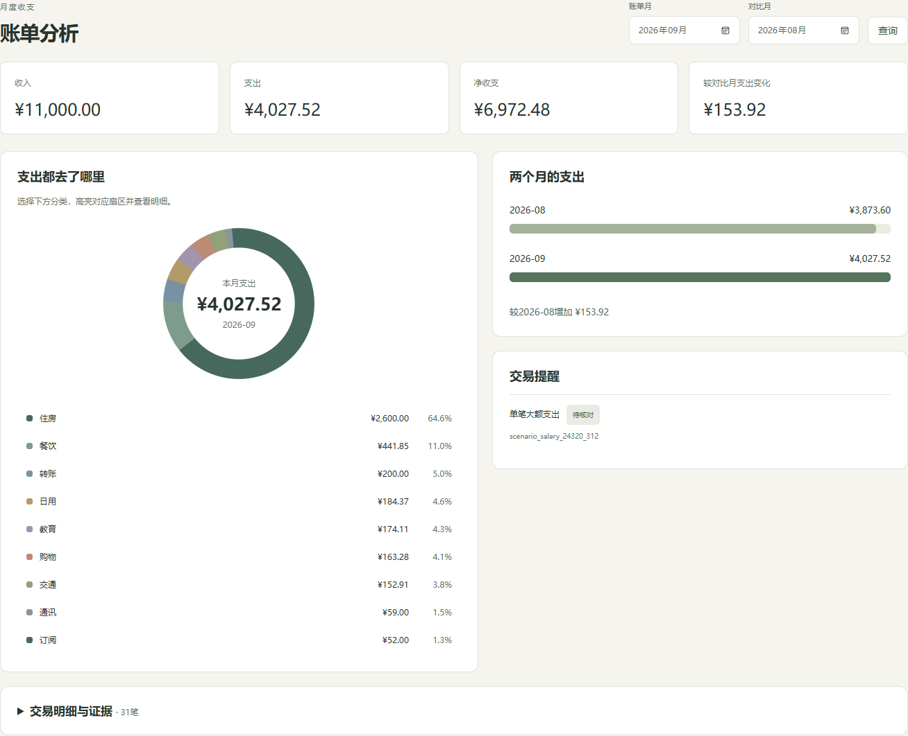
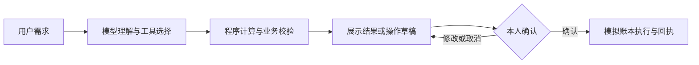
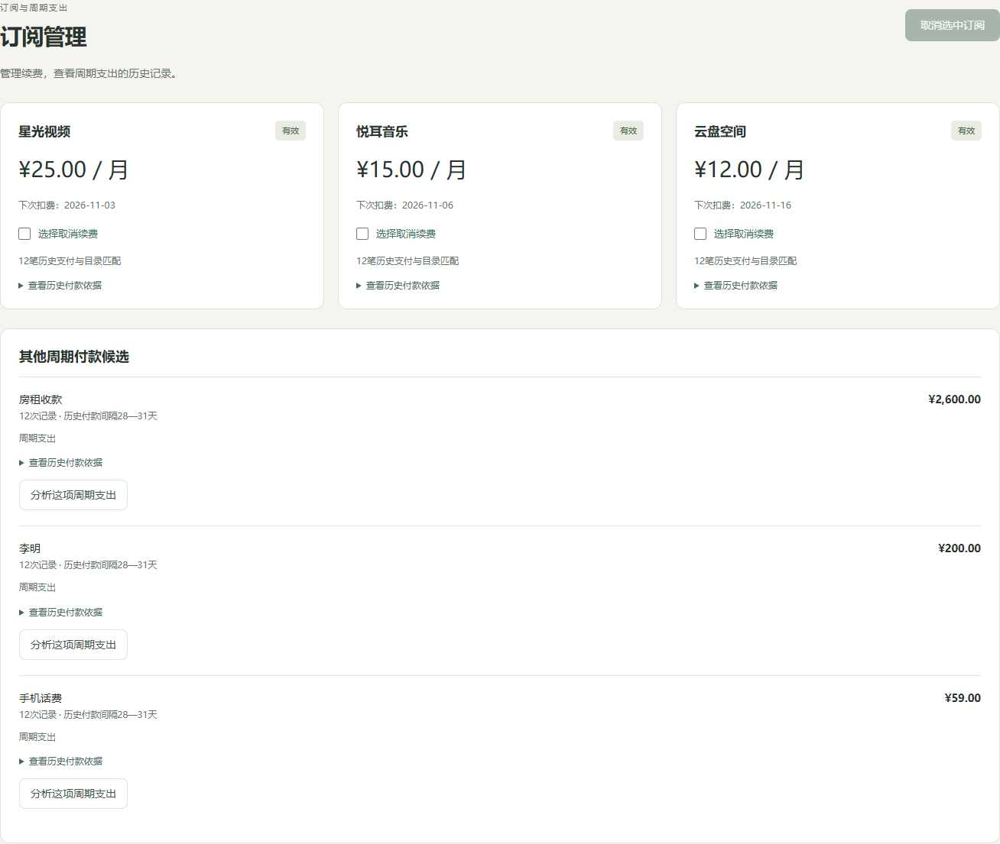
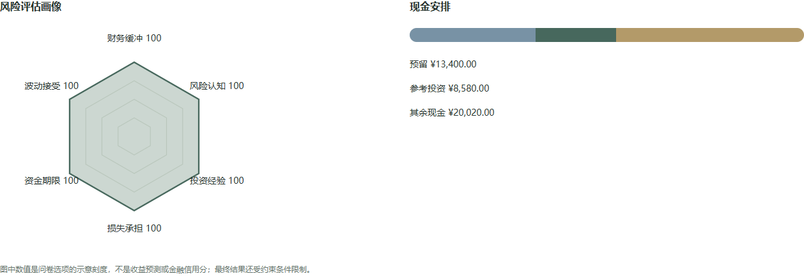

# 智人银行 · Bank AI Agent

用自然语言查询账单、管理订阅、准备模拟转账，并通过可核对的业务规则完成确认。

这是深圳大学智人队的金融科技竞赛原型，使用 AI 编程助手协作开发。本仓库展示应用实现、业务流程、测试与功能截图；账户和资金操作均为合成数据，不连接真实银行账户。



## 主要能力

| 场景 | 已实现的行为 |
|---|---|
| 账单分析 | 月度收支、分类汇总、月份比较，联动图表与交易明细 |
| 智能转账 | 收款人消歧、最低资金预留、草稿确认、重复请求防重 |
| 订阅管理 | 识别周期付款候选，展示续费信息，逐项确认取消模拟订阅 |
| 理财查询 | 风险问卷、风险画像与现金安排，查询附来源和日期的银行产品资料 |
| 跨场景任务 | 按步骤依赖执行，支持暂停、恢复、取消和部分成功保留 |

例如：“分析上月开销，取消我选中的两项订阅，再给指定收款人转账，并保留生活费。”

## 工作机制



金额由程序以整数分计算；变更操作绑定操作 ID 与版本，并在执行时重新检查权限、余额和预留要求。模型不能直接扣款或执行任意 SQL。

## 功能截图

截图来自 2026-11-01 的隔离模拟账户。它们展示当时已实现的界面，不代表实时银行数据。

| 订阅管理 | 风险画像 |
|---|---|
|  |  |


## 本地运行

需要 Python 3.13+。建议先查看截图；实际模型对话需要使用你自己的模型 API，可能产生费用。

**Windows PowerShell：**

```powershell
powershell -NoProfile -ExecutionPolicy Bypass -File scripts/setup.ps1
```

若默认 Python 版本较低，可用 `-Python "你的Python3.13可执行文件路径"` 指定。

在自动创建的 `.env` 中填入自己的 `DEEPSEEK_API_KEY`，确认模型配置，然后双击 `start.cmd`。网页地址为 `http://127.0.0.1:8765/`。

也可手动安装和启动：

```text
python -m venv .venv
.venv\Scripts\python -m pip install -r requirements.txt
```

复制 `.env.example` 为 `.env`，配置后运行 `.venv\Scripts\python run.py`。

示例账户为 `alice`、`bob`，演示密码为 `demo2026`。首次启动创建本地合成账本。没有模型密钥时仍可查看基础页面，AI 对话不可用。

可选的三情境演示：`.venv\Scripts\python scripts/scenario_server.py`，地址为 `http://127.0.0.1:8768/`，与普通账本隔离。

## 测试

```text
.venv\Scripts\python -m pytest -q
```

公开版保留业务回归用例，移除了仅针对私有赛事评审包的打包测试。测试夹具中的历史模拟理财功能不等于当前界面提供申购或赎回；测试通过不能替代真实业务验证。验证记录见 [验证说明](docs/validation.md)。

## 技术与目录

Python · FastAPI · SQLite · HTTPX · 原生 JavaScript / CSS

- `app/agent.py`、`app/tools.py`：需求理解、工具循环与参数约束。
- `app/service.py`：草稿、业务规则、确认与防重。
- `app/bank_market.py`：官网数据来源、缓存与失败处理。
- `static/`：网页、账单图表和交互。
- `tests/`：业务与接口回归。

## 范围与来源

公开版不附模型密钥、原电脑账本、运行日志、私有评审包或历史 Git 记录。仓库未授予额外的开源许可证，第三方组件授权见 [第三方说明](THIRD_PARTY.md)。

理财问卷为项目演示规则；官网产品仅供浏览，不提供银行申购渠道。本地演示账户及未加密模拟数据库不用于真实金融账户。模型可能解释错误，操作结果仍需人工核对。

周锦鹏在项目中提出功能范围、真实银行产品接入、风险展示与交付体验方面的需求，结合试用反馈推动迭代；代码与材料制作使用 Codex 等 AI 工具辅助。这里不将团队或 AI 产出描述为个人独立研发。


